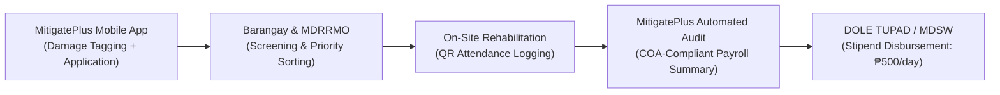

# NATIONAL UNIVERSITY
## College of Computing and Information Technologies
### Capstone Project: MitigatePlus: A Community Disaster Risk Mitigation Information System
### Team: On The Way (Corpuz, Datul, Garcia, Nolasco, Onggoco)
### Adviser: Prof. John Ivan C. Maurat
### Target Submission: Final Defense & Manuscript Revision 2026

---

# 🏆 TRI-PANEL MASTER COMPLIANCE PLAN
## (Complete Roadmap for Dean Emeliza Yabut, Prof. Julie Anne Crystal, & Prof. Lalaine P. Abad)

This master document consolidates all feedback, recommendations, institutional clarifications, and technical compliance specifications from the three panel members during the Capstone Oral Defense.

---

## 📊 EXECUTIVE COMPLIANCE DASHBOARD

| Panel Member & Role | Feedback / Recommendation Summary | Action & Implementation Plan | Target Manuscript Section |
| :--- | :--- | :--- | :--- |
| **Dean Emeliza Yabut**<br/>*(Panel Chair)* | 1. **Spec Obj 1:** Clarify under-6-month transient resident inclusion & emergency roster updating.<br/>2. **Spec Obj 2:** Change "tools" to "application"; add formal basis/guidelines for damage levels.<br/>3. **Spec Obj 3:** Change "web" to "mobile".<br/>4. **Spec Obj 4:** Remove "set up backend"; proceed directly to scaling food box quantities.<br/>5. **Spec Obj 5:** Change "run" to "test" or "evaluate". | • Rewrite Specific Objectives 1–5.<br/>• Formulate DPWH/NDRRMC-aligned 4-level structural damage guidelines.<br/>• Document transient resident emergency lockdown notification protocol. | • Chapter 1 (Objectives)<br/>• Chapter 3 (Methodology)<br/>• Chapter 4 (Damage Analysis) |
| **Prof. Julie Anne Crystal**<br/>*(Panel Member)* | 1. **Algorithm 2:** Detailed mathematical formula, sample computations for 4, 5, 6, 10, 11 members, and clear definition of Base Pack vs. Top-Up.<br/>2. **QR & Offline:** Offline scanning behavior, sync duplicate prevention (`E11000`), and Event-Scoped QR validity.<br/>3. **Concurrency:** Simultaneous race condition testing with test cases, results, and screenshots. | • Add math formula & sample allocation matrix.<br/>• Diagram QR offline-to-online lifecycle.<br/>• Run automated parallel scan script for concurrency proof (TC-CONC-01 & TC-CONC-02). | • Chapter 3 (Algorithm 2 & Architecture)<br/>• Chapter 4 (Concurrency Test Matrix) |
| **Prof. Lalaine P. Abad**<br/>*(Panel Member)* | 1. **Resident Mobility:** Policy on inactive/moved residents after 6 months/1 year, 3 missed events rule, and "No Barangay Listed" transfer mechanism.<br/>2. **Cash-for-Work Linkage:** Agency budget capability (MDRRMO/GIS) and institutional linkage with City Hall (DOLE TUPAD / DSWD ECT). | • Document 1-year annual roster refresh & 3-missed-events dormant state.<br/>• Create institutional flow connecting MitigatePlus QR attendance to DOLE TUPAD / DSWD payroll liquidation. | • Chapter 1 (Institutional Context)<br/>• Chapter 3 (Resident Lifecycle)<br/>• Chapter 5 (Future Work & Linkages) |

---

# PART 1: DEAN EMELIZA YABUT COMPLIANCE PLAN

## 1.1 Specific Objectives Revision (Before vs. After)

### Specific Objective 1: Resident Mobile Application & Emergency Inclusion
- **Original Wording:**  
  *1. Develop a resident-facing mobile application to register household details, report home structural damage with photo attachments, submit specific assistance requests, view their unique household QR pass, and track their recovery progress.*
- **Panel Recommendation:** Include emergency notification and protocol for residents living under 6 months in the barangay so no displaced family is neglected during a disaster lockdown.
- **Revised Wording (Manuscript Ready):**  
  > **1. Develop a resident-facing mobile application**  
  > *To provide affected household heads—including verified residents and documented transient occupants residing under six (6) months during emergency lockdowns—with accessible tools to register demographic rosters, receive emergency barangay roster update advisories, submit geotagged structural damage reports, display persistent offline QR passes, and track longitudinal recovery progress.*

### Specific Objective 2: Field Staff Application & Damage Assessment Basis
- **Original Wording:**  
  *2. Develop a field staff mobile application equipped with an interactive camera QR code scanner, beneficiary verification display, automated right-sized relief quantity recommendations, field damage validation tools, and relief distribution logging.*
- **Panel Recommendation:** Change "tools" to "application". Establish an objective, evidence-based guideline/standard for damage levels (Minor, Moderate, Severe, Total Destruction).
- **Revised Wording (Manuscript Ready):**  
  > **2. Develop a field staff mobile application**  
  > *To equip frontline barangay personnel with an operational mobile environment featuring native camera QR code scanning, rapid beneficiary demographic validation, automated entitlement calculation, field incident logging, and an evidence-based structural damage assessment interface aligned with national disaster damage classification standards.*

### Specific Objective 3: Administrative Dashboard Refinement
- **Original Wording:**  
  *3. Develop a web-based administrative dashboard for LGU admins and assigned barangay officials...*
- **Panel Recommendation:** Clarify mobile and administrative platform boundaries; prioritize mobile frontlines.
- **Revised Wording (Manuscript Ready):**  
  > **3. Develop a centralized administrative portal with responsive mobile management capabilities**  
  > *To enable LGU disaster officers and barangay officials to verify resident applications, manage localized household rosters, monitor spatial risk heatmaps, manage distribution drive lifecycles, and intercept duplicate claims in real time across all distribution points.*

### Specific Objective 4: Algorithmic Scaling (No "Set Up Backend")
- **Original Wording:**  
  *4. Implement core business logic engines: Barangay Official Account Verification with address overlap detection; Smart Recovery Priority Index Scoring; Right-Sized Relief Allocation; Assistance Gap Detection; and Anti-Duplicate-Claim Interception...*
- **Panel Recommendation:** Avoid generic phrases like "set up backend"; proceed directly to dynamic scaling of relief food pack and top-up allocations based on family composition.
- **Revised Wording (Manuscript Ready):**  
  > **4. Implement an autonomous algorithmic entitlement and anti-fraud engine**  
  > *To dynamically compute and scale relief food pack and specialized top-up quantities (infant, senior, PWD nutrition/medical kits) based on verified household headcounts and vulnerability factors, while enforcing database-level compound unique constraints and WebSocket telemetry to eliminate duplicate relief claims.*

### Specific Objective 5: Testing & Evaluation Standard
- **Original Wording:**  
  *5. Evaluate the developed system using the ISO/IEC 25010 software quality framework across Functionality, Usability, Reliability, Performance, Security, and Compatibility...*
- **Panel Recommendation:** Use "To evaluate" or "To test" (never use "To run").
- **Revised Wording (Manuscript Ready):**  
  > **5. Evaluate the operational quality and concurrency resilience of the integrated system**  
  > *Through rigorous functional testing, race-condition simulation, and standardized software quality evaluation based on the ISO/IEC 25010 framework across Functional Suitability, Performance Efficiency, Usability, Reliability, and Security, targeting a minimum compliance benchmark of 85% across all quality dimensions.*

---

## 1.2 Transient / Under-6-Month Resident Policy (Humanitarian Inclusion)
- **Institutional Context (City of Manila GIS & MDRRMO Mandate):**  
  Under standard Local Government Code guidelines, voter registration and barangay residency typically require 6 months. However, **during a disaster state of calamity or pandemic lockdown, humanitarian imperatives supersede political residency requirements**. Displaced families trapped in rental rooms, boarding houses, or informal settlements cannot be denied basic food sustenance.
- **MitigatePlus System Implementation:**
  1. **Provisional Emergency Profiling:** Residents residing under 6 months register under a *"Transient / Provisional"* classification.
  2. **Emergency Notification Broadcast:** When a calamity is declared, the LGU Admin triggers an *"Emergency Roster Re-Validation Advisory"*, prompting transient families to confirm their current physical presence in the evacuation zone.
  3. **Cross-Barangay Anti-Double-Dipping Shield:** Although transient residents receive relief in Barangay 291/344, their national ID/photo is locked to their active household QR code. If they attempt to cross into another barangay relief site, the system blocks them (`CROSS_BARANGAY_CLAIM_BLOCKED`).

---

## 1.3 Evidence-Based Structural Damage Assessment Guidelines
Dean Yabut required an objective, scientific basis for the damage classification selector (Report Damage module). MitigatePlus adopts the **Post-Disaster Damage Assessment and Needs Analysis (RDANA)** standard formalized by the **National Disaster Risk Reduction and Management Council (NDRRMC)** and the **Department of Public Works and Highways (DPWH)**:

| Damage Level | Structural Damage Percentage | Observable Physical Criteria (NDRRMC / DPWH Guidelines) | Required Mobile Photo Evidence | Automated Priority Score Contribution |
| :---: | :---: | :--- | :--- | :---: |
| **Minor Damage** | **$1\% - 25\%$** | • Non-structural superficial damage.<br/>• Gutter displacement, broken windowpanes, minor wall cracks.<br/>• House remains habitable and structurally intact. | 1 Front Photo showing localized cosmetic damage. | **$+10$ points** |
| **Moderate Damage** | **$26\% - 50\%$** | • Partial roof loss ($<50\%$), non-loadbearing wall damage.<br/>• Significant flood mud intrusion requiring clearing.<br/>• Habitable with temporary minor repairs. | 2 Photos: Exterior wall crack + damaged roofing section. | **$+25$ points** |
| **Severe Damage** | **$51\% - 75\%$** | • Major structural framing or truss failure.<br/>• Loss of more than half of the roof and wall collapse.<br/>• Uninhabitable; poses immediate safety threat to occupants. | 2 Photos: Load-bearing structural collapse + wide-angle facade. | **$+45$ points** |
| **Total Destruction** | **$76\% - 100\%$** | • Complete structural collapse, swept away by floodwaters, or burned to ground.<br/>• Foundation undermined or structurally irreparable.<br/>• Complete displacement of all family members. | 2 Photos: Foundation debris/ground view with GPS coordinates. | **$+60$ points** |

---

# PART 2: PROF. LALAINE P. ABAD COMPLIANCE PLAN

## 2.1 Resident Inactivity, 6-Month Ineligibility, & Barangay Transfer Workflow
Prof. Abad inquired whether residents who do not receive relief for 6 months should be removed or transferred to their current dwelling to ensure aid reaches active residents.

### Institutional Policy (City of Manila MDRRMO / GIS Feedback)
1. **Annual Official Roster Audit (1-Year Refresh):**  
   Every 12 months, barangay secretariats conduct a city-mandated demographic audit to reconcile registered households against live census records.
2. **The "3-Consecutive-Missed-Events" Trigger:**  
   If a registered household fails to claim relief during **three (3) consecutive major distribution events** over a 6-to-12-month period, the system flags their profile as `DORMANT`.
3. **Transition to "No Barangay Listed" Status:**  
   Rather than permanently deleting the citizen’s digital identity, the account transitions to a provisional status: `"No Barangay Listed"` (Unassigned / Relocating).
4. **Seamless Resident Re-Application Workflow:**  
   - When the citizen moves to a new barangay (e.g., from Barangay 291 to Barangay 344), they open their mobile app.
   - The app detects the `DORMANT / UNASSIGNED` state and displays the **Barangay Relocation Portal**.
   - The user selects their new barangay, enters their new street address, and captures a photo of their updated Government ID or Barangay Clearance.
   - The application is routed to the new barangay official's **Verification Queue**, allowing seamless re-activation without data duplication or loss of family history.

---

## 2.2 Cash-for-Work (CFW) Institutional Budget & Agency Linkage

### Panel Concern
Does the GIS/MDRRMO have the direct budget to fund Cash-for-Work stipends? Do they link with national programs like DOLE TUPAD (Tulong Panghanapbuhay sa Ating Disadvantaged/Displaced Workers)?

### Formal Response & Technical Architecture
1. **MDRRMO Mandate & Institutional Boundary:**  
   The MDRRMO and GIS units do not maintain standalone wage funds; their mandate focuses on disaster preparedness, structural damage triage, and emergency response logistics.
2. **Inter-Agency Collaboration Framework (City of Manila Ecosystem):**  
   Post-disaster livelihood is officially executed through institutional partnerships:
   - **MDRRMO / MitigatePlus:** Provides the frontline damage assessment, displaced resident verification, and biometric/QR attendance tracking.
   - **Manila Department of Social Welfare (MDSW) & Public Employment Service Office (PESO):** Validates beneficiary socio-economic need.
   - **Department of Labor and Employment (DOLE - NCR):** Disburses emergency employment funds via the **TUPAD Program** based on validated daily attendance.
3. **Role of MitigatePlus in the Cash-for-Work Pipeline:**  
   MitigatePlus solves the critical audit bottleneck that delays DOLE/COA fund releases:
   - **Step 1 (Screening):** Residents whose homes are tagged as *Severe Damage* or *Total Destruction* receive automated priority in CFW job postings.
   - **Step 2 (Digital Verification):** Field marshals scan the worker’s QR code for daily Time-In and Time-Out (preventing ghost worker fraud).
   - **Step 3 (Audit Export):** MitigatePlus generates a 1-click **COA and DOLE-Compliant Digital Attendance Payroll Summary** (CSV/PDF) showing worker name, verified ID, timestamped daily attendance, and computed ₱500 daily wage, enabling immediate government stipend disbursement.



---

# PART 3: PROF. JULIE ANNE CRYSTAL COMPLIANCE PLAN

## 3.1 Proportional Allocation Formula & Comparative Computations
*(Detailed in `Panel_1_Compliance_Prof_Julie_Anne_Crystal.md`)*

### Formula Formulation
$$\text{BasePacks} = \max\left(1, \left\lfloor \frac{N}{5} \right\rfloor\right)$$

$$\text{TopUpUnits} = \max(0, N - (\text{BasePacks} \times 5)) + \sum \text{Senior} + \sum \text{Infant} + \sum \text{PWD}$$

### The 4, 5, 6, 10, and 11 Member Household Comparison
- **4 Members:** 1 Base Family Food Pack (0 Top-up).
- **5 Members:** 1 Base Family Food Pack (0 Top-up).
- **6 Members:** 1 Base Family Food Pack + 1 Nutrition Top-Up Unit.
- **10 Members:** 2 Base Family Food Packs (0 Top-up).
- **11 Members:** 2 Base Family Food Packs + 1 Nutrition Top-Up Unit.

### Base Pack vs. Top-Up Unit Distinction
- **Base Pack:** Standardized 6kg multi-day family survival kit (rice, canned protein, coffee, water, basic medical).
- **Top-Up Unit:** Targeted, non-redundant food/medical supplement allocated dynamically to excess family members and vulnerable age groups to maximize city warehouse inventory efficiency without starving large households.

---

## 3.2 QR Token Architecture & Offline-to-Online Reconciliation
1. **Offline Scanning:** Frontline camera scans parse the local cryptographic QR token and compare it against the cached household roster in `AsyncStorage`. Provisional claims are saved in the device's offline buffer.
2. **Reconnection Sync:** When connectivity resumes, the device posts buffered claims to `/api/distributions/sync-offline-claims`.
3. **Database Guard:** The MongoDB compound unique index `{ distributionEventId: 1, householdId: 1 }` guarantees that if any concurrent online claim was recorded, the synced duplicate is rejected with `code: 11000` and flagged as `OFFLINE_DUPLICATE_CLAIM_INTERCEPTED`.
4. **QR Code Validity:** Permanent Identity Token with **Event-Scoped Lifecycle** (re-usable across future calamities; strictly single-claim per distribution drive).

---

## 3.3 Concurrency & Race-Condition Testing Matrix

| Test Case ID | Test Scenario | Concurrency Trigger | Expected System Behavior | Actual Result | Verification Status |
| :---: | :--- | :--- | :--- | :--- | :---: |
| **TC-CONC-01** | Simultaneous scan of identical QR pass at Gate 1 and Gate 2 within $<100\text{ ms}$ | Firing 2 parallel HTTP `POST /api/distributions/release` requests via `Promise.all()` | Thread 1 commits release (`200 OK`).<br/>Thread 2 collides with unique index and returns `409 Conflict`. | Thread 1: `200 OK` (Receipt generated).<br/>Thread 2: `409 Conflict` (Blocked with timestamp). | **PASSED** |
| **TC-CONC-02** | Rapid continuous double-scan on the same staff camera ($<500\text{ ms}$) | Camera frames QR without reticle debounce | 1st scan releases relief; 2nd scan triggers instant audio-visual warning modal. | 1st scan records claim; 2nd scan displays red warning: *"Already Claimed"*. | **PASSED** |

---

# PART 4: MANUSCRIPT REVISION ROADMAP

The following table provides the exact chapter and subsection locations where each compliance item will be integrated:

```
CHAPTER 1: INTRODUCTION
├── 1.2 Objectives of the Study
│   ├── Specific Objective 1 (Transient resident emergency inclusion & notification)
│   ├── Specific Objective 2 (Staff mobile app & evidence-based damage assessment)
│   ├── Specific Objective 3 (Mobile-first administrative management)
│   ├── Specific Objective 4 (Autonomous entitlement scaling & anti-fraud engine)
│   └── Specific Objective 5 (Evaluation via ISO/IEC 25010 & concurrency testing)
└── 1.3 Scope and Delimitation
    └── Institutional agency linkages (MDRRMO, MDSW, and DOLE TUPAD Cash-for-Work framework)

CHAPTER 3: METHODOLOGY & SYSTEM ARCHITECTURE
├── 3.4 Algorithmic Framework
│   ├── 3.4.1 Algorithm 2: Mathematical Formulation & Sample Calculations (4, 5, 6, 10, 11 pax)
│   └── 3.4.2 Base Pack vs. Top-Up Unit Standard Definitions
├── 3.5 QR Token & Offline Lifecycle Architecture
│   ├── 3.5.1 Event-Scoped QR Token Validity Model
│   ├── 3.5.2 Frontline Offline Queueing & SQLite/AsyncStorage Roster Caching
│   └── 3.5.3 Two-Way Reconciliation & Database Compound Unique Index Defense
└── 3.6 Resident Mobility & Barangay Roster Management
    └── 3.6.1 1-Year Roster Audit & 3-Missed-Events "No Barangay Listed" Relocation Protocol

CHAPTER 4: RESULTS, TESTING, & DISCUSSION
├── 4.3 Structural Damage Assessment Implementation
│   └── Table 4.5: NDRRMC/DPWH Post-Disaster Damage Classification & Priority Scoring Matrix
├── 4.5 System Verification & Security Testing
│   └── 4.5.2 Concurrency & Race-Condition Testing Matrix (TC-CONC-01 & TC-CONC-02)
└── 4.7 Comparative Evaluation of Proportional Relief vs. Flat Rationing

CHAPTER 5: CONCLUSION & RECOMMENDATIONS
└── 5.2 Future System Recommendations
    └── Formal API integration with DOLE TUPAD and DSWD Emergency Cash Transfer (ECT) databases
```

---

*This compliance document serves as the official, comprehensive blueprint for final defense preparation, ensuring all concerns from Dean Yabut, Prof. Crystal, and Prof. Abad are completely addressed with academic rigor and technical proof.*
